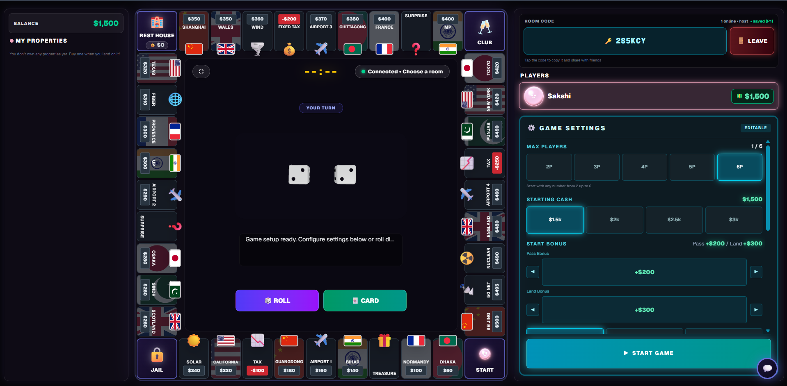

# Monopoly Online

A real-time multiplayer board game built with Next.js, TypeScript, Node.js, Express, and Socket.IO. The application supports multiplayer rooms, property management, auctions, trading, and server-authoritative game actions.


**[Live Demo](https://monopoly-pied-seven.vercel.app/) · [Source Code](https://github.com/Cykshi/monopoly-) · [Report an Issue](https://github.com/Cykshi/monopoly-/issues)**

## Gameplay



## Key Features

- **Real-Time Multiplayer:** Room-based gameplay with synchronized player and game-state updates using Socket.IO.
- **Server-Authoritative Game Logic:** Backend validation of critical actions to prevent clients from directly controlling important game outcomes.
- **Property Management:** Property purchases, rent collection, and property upgrades.
- **Auctions and Trading:** Multiplayer bidding and player-to-player asset transactions.
- **Turn and Jail Mechanics:** Turn management, dice rolls, movement rules, and jail-related actions.
- **Game State Persistence:** Support for saving and restoring game sessions.
- **Responsive UI:** Interactive browser-based interface built with React and Tailwind CSS.

## Tech Stack

| Layer | Technologies |
|---|---|
| Frontend | Next.js, React, TypeScript |
| Styling | Tailwind CSS |
| Backend | Node.js, Express |
| Real-Time Communication | Socket.IO |
| Deployment | Vercel, Render |

## Architecture

The application uses a client-server architecture. The Next.js frontend provides the user interface, while the Express backend manages game actions, multiplayer communication, validation, and persistence. Socket.IO enables real-time updates between connected players.

## Run Locally

### Prerequisites

- Node.js and npm
- Git

### 1. Clone the repository

```bash
git clone https://github.com/Cykshi/monopoly-.git
cd monopoly-
```

### 2. Start the backend

```bash
cd backend
npm install
```

Configure the environment variables using `backend/.env.example`, then run the start script defined in `backend/package.json`.

### 3. Start the frontend

In a separate terminal:

```bash
cd frontend
npm install
```

Configure `NEXT_PUBLIC_SOCKET_URL` in `frontend/.env.local` to point to your local backend, then start the development server:

```bash
npm run dev
```

Open [http://localhost:3000](http://localhost:3000) in your browser.

## Testing

The backend includes tests for game-action validation, turn authority, player identity, auctions, jail mechanics, and game-state restoration.

Run the relevant test scripts from the `backend` directory as specified by the project configuration.

## Author

**Cykshi** · [GitHub](https://github.com/Cykshi)
